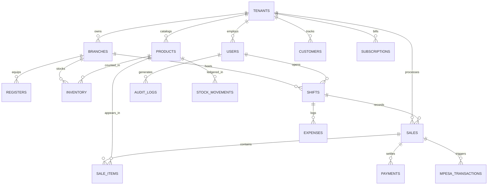

# Database Schema: Enterprise Supermarket POS SaaS Platform

This document defines the relational database architecture supporting multi-tenant supermarket retail operations in Kenya (KES currency, M-Pesa integration, KRA eTIMS, Cashier Shifts, and Biometric Supervisor controls).

---

## Entity Relationship Overview

---

## 1. Multi-Tenant & Subscription Tables

### `tenants`
| Column | Type | Constraints | Description |
| :--- | :--- | :--- | :--- |
| `id` | VARCHAR(64) | PRIMARY KEY | Unique tenant ID (e.g. `tenant_naivas_01`) |
| `name` | VARCHAR(128) | NOT NULL | Registered Business Legal Name |
| `slug` | VARCHAR(64) | UNIQUE NOT NULL | URL-safe identifier (e.g. `naivas`) |
| `trade_name` | VARCHAR(128) | NOT NULL | Storefront brand name |
| `kra_pin` | VARCHAR(20) | NOT NULL | KRA Tax PIN (e.g. `P051234567Z`) |
| `phone` | VARCHAR(20) | NOT NULL | Primary contact phone |
| `email` | VARCHAR(128) | UNIQUE NOT NULL | Business administrative email |
| `currency` | VARCHAR(3) | DEFAULT 'KES' | Base operating currency |
| `plan_id` | VARCHAR(32) | NOT NULL | Current subscription tier (`starter`, `growth`, `enterprise`) |
| `status` | VARCHAR(20) | DEFAULT 'ACTIVE' | `ACTIVE`, `TRIAL`, `SUSPENDED`, `EXPIRED` |
| `trial_ends_at` | DATETIME | | Trial period expiry timestamp |
| `subscription_expires_at` | DATETIME | | Paid subscription expiry timestamp |
| `created_at` | DATETIME | DEFAULT CURRENT_TIMESTAMP | |

### `plans`
| Column | Type | Constraints | Description |
| :--- | :--- | :--- | :--- |
| `id` | VARCHAR(32) | PRIMARY KEY | Plan ID (`starter`, `growth`, `enterprise`) |
| `name` | VARCHAR(64) | NOT NULL | Display name |
| `price_kes` | DECIMAL(10,2) | NOT NULL | Price in Kenyan Shillings |
| `billing_cycle` | VARCHAR(20) | NOT NULL | `MONTHLY`, `ANNUAL` |
| `max_branches` | INTEGER | NOT NULL | Branch quota |
| `max_registers` | INTEGER | NOT NULL | POS till quota |
| `max_skus` | INTEGER | NOT NULL | Product SKU quota |
| `features_json` | TEXT | | JSON feature flags |

---

## 2. Organization, Branch & Staff Tables

### `branches`
| Column | Type | Constraints | Description |
| :--- | :--- | :--- | :--- |
| `id` | VARCHAR(64) | PRIMARY KEY | Branch ID (e.g. `BR-001`) |
| `tenant_id` | VARCHAR(64) | NOT NULL REFERENCES tenants(id) | Tenant owner |
| `code` | VARCHAR(16) | NOT NULL | Short branch code (e.g. `CBD-01`) |
| `name` | VARCHAR(128) | NOT NULL | Branch name (e.g. `Nairobi CBD MegaStore`) |
| `location` | VARCHAR(128) | NOT NULL | City / Town / County |
| `phone` | VARCHAR(20) | | Branch direct line |
| `status` | VARCHAR(20) | DEFAULT 'ACTIVE' | `ACTIVE`, `INACTIVE` |

### `registers` (POS Tills)
| Column | Type | Constraints | Description |
| :--- | :--- | :--- | :--- |
| `id` | VARCHAR(64) | PRIMARY KEY | Register till ID (e.g. `REG-01`) |
| `tenant_id` | VARCHAR(64) | NOT NULL REFERENCES tenants(id) | Tenant owner |
| `branch_id` | VARCHAR(64) | NOT NULL REFERENCES branches(id) | Assigned store branch |
| `code` | VARCHAR(16) | NOT NULL | Till code (e.g. `TILL-01`) |
| `name` | VARCHAR(64) | NOT NULL | Counter lane name |
| `printer_type` | VARCHAR(20) | DEFAULT 'ESC_POS_80MM' | `ESC_POS_58MM`, `ESC_POS_80MM`, `PDF` |
| `status` | VARCHAR(20) | DEFAULT 'ONLINE' | |

### `users`
| Column | Type | Constraints | Description |
| :--- | :--- | :--- | :--- |
| `id` | VARCHAR(64) | PRIMARY KEY | User ID (e.g. `usr_cashier_01`) |
| `tenant_id` | VARCHAR(64) | NOT NULL | Tenant ID (`GLOBAL` for super admin) |
| `username` | VARCHAR(64) | NOT NULL | Login username |
| `email` | VARCHAR(128) | NOT NULL | Email address |
| `password_hash`| VARCHAR(255) | NOT NULL | PBKDF2 / Bcrypt secure hash |
| `full_name` | VARCHAR(128) | NOT NULL | Full employee name |
| `phone` | VARCHAR(20) | | Mobile number |
| `role` | VARCHAR(32) | NOT NULL | One of 10 RBAC roles |
| `branch_id` | VARCHAR(64) | | Branch assignment (`ALL` for admins) |
| `permissions_json` | TEXT | | Array of granted permissions |
| `pin_code` | VARCHAR(16) | | Quick login PIN for cashiers |
| `active` | BOOLEAN | DEFAULT 1 | Active account status |
| `locked_until` | DATETIME | | Lockout timestamp |

---

## 3. Product Catalog & Inventory Ledger

### `products`
| Column | Type | Constraints | Description |
| :--- | :--- | :--- | :--- |
| `id` | VARCHAR(64) | PRIMARY KEY | Product ID (e.g. `PRD-61611000001`) |
| `tenant_id` | VARCHAR(64) | NOT NULL REFERENCES tenants(id) | Tenant owner |
| `name` | VARCHAR(255) | NOT NULL | Product Title (e.g. `Unga Jogoo Maize Flour 2kg`) |
| `barcode` | VARCHAR(64) | NOT NULL | EAN-13 / Code128 barcode |
| `sku` | VARCHAR(64) | NOT NULL | Internal Stock Keeping Unit |
| `category` | VARCHAR(64) | NOT NULL | Category name |
| `unit` | VARCHAR(20) | DEFAULT 'PCS' | Unit of measurement (`PCS`, `KG`, `LTR`, `PKT`) |
| `cost_price_kes` | DECIMAL(10,2) | NOT NULL | Acquisition cost |
| `selling_price_kes` | DECIMAL(10,2) | NOT NULL | Retail selling price in KES |
| `wholesale_price_kes`| DECIMAL(10,2) | | Bulk sale price |
| `vat_rate` | DECIMAL(4,2) | DEFAULT 16.0 | VAT % (`16.0` standard, `0.0` zero-rated, `-1.0` exempt) |
| `min_stock` | INTEGER | DEFAULT 5 | Minimum threshold for reorder alert |
| `is_weighed` | BOOLEAN | DEFAULT 0 | 1 if weighed by electronic scale at till |
| `is_active` | BOOLEAN | DEFAULT 1 | |

### `inventory`
| Column | Type | Constraints | Description |
| :--- | :--- | :--- | :--- |
| `id` | VARCHAR(64) | PRIMARY KEY | |
| `tenant_id` | VARCHAR(64) | NOT NULL | Tenant scope |
| `branch_id` | VARCHAR(64) | NOT NULL REFERENCES branches(id) | Branch location |
| `product_id` | VARCHAR(64) | NOT NULL REFERENCES products(id) | Catalog product |
| `quantity` | DECIMAL(10,3) | NOT NULL DEFAULT 0.000 | Current stock on hand |
| `reorder_level`| INTEGER | DEFAULT 10 | Reorder notification level |

### `stock_movements` (Double-Entry Inventory Ledger)
| Column | Type | Constraints | Description |
| :--- | :--- | :--- | :--- |
| `id` | VARCHAR(64) | PRIMARY KEY | Transaction ledger ID |
| `tenant_id` | VARCHAR(64) | NOT NULL | Tenant scope |
| `branch_id` | VARCHAR(64) | NOT NULL | Location |
| `product_id` | VARCHAR(64) | NOT NULL | Product item |
| `movement_type`| VARCHAR(20) | NOT NULL | `SALE`, `RECEIVE`, `ADJUSTMENT`, `RETURN`, `TRANSFER_OUT`, `TRANSFER_IN`, `DAMAGE` |
| `quantity` | DECIMAL(10,3) | NOT NULL | Delta quantity (positive or negative) |
| `balance_after`| DECIMAL(10,3) | NOT NULL | Running balance snapshot |
| `reference_id` | VARCHAR(64) | | Sale ID or Purchase Order ID |
| `created_by` | VARCHAR(64) | NOT NULL | User accountable |
| `created_at` | DATETIME | DEFAULT CURRENT_TIMESTAMP | |

---

## 4. Cashier Shifts & Cash Reconciliation

### `shifts`
| Column | Type | Constraints | Description |
| :--- | :--- | :--- | :--- |
| `id` | VARCHAR(64) | PRIMARY KEY | Shift ID (e.g. `SHIFT-20261109-01`) |
| `tenant_id` | VARCHAR(64) | NOT NULL | Tenant scope |
| `branch_id` | VARCHAR(64) | NOT NULL | Branch |
| `register_id` | VARCHAR(64) | NOT NULL | Register till |
| `cashier_id` | VARCHAR(64) | NOT NULL | Cashier |
| `status` | VARCHAR(20) | DEFAULT 'OPEN' | `OPEN`, `CLOSED` |
| `opened_at` | DATETIME | NOT NULL | Start timestamp |
| `closed_at` | DATETIME | | Closing timestamp |
| `opening_float_kes` | DECIMAL(10,2) | NOT NULL | Initial physical cash in till |
| `closing_cash_kes` | DECIMAL(10,2) | | Physical cash counted at close |
| `expected_cash_kes`| DECIMAL(10,2) | | `Opening Float + Cash Sales + Cash In - Cash Out - Refunds` |
| `variance_kes` | DECIMAL(10,2) | | `Closing Cash - Expected Cash` (Surplus or Shortage) |
| `cash_sales_kes` | DECIMAL(10,2) | DEFAULT 0.00 | Total cash collected |
| `mpesa_sales_kes`| DECIMAL(10,2) | DEFAULT 0.00 | Total M-Pesa collected (not in drawer) |
| `card_sales_kes` | DECIMAL(10,2) | DEFAULT 0.00 | Total card sales |
| `notes` | TEXT | | Discrepancy or handover notes |
| `approved_by` | VARCHAR(64) | | Supervisor approval ID |

---

## 5. Sales, Payments & M-Pesa Transactions

### `sales`
| Column | Type | Constraints | Description |
| :--- | :--- | :--- | :--- |
| `id` | VARCHAR(64) | PRIMARY KEY | Transaction invoice (e.g. `TX-KES-10492`) |
| `tenant_id` | VARCHAR(64) | NOT NULL | Tenant scope |
| `branch_id` | VARCHAR(64) | NOT NULL | Branch |
| `register_id` | VARCHAR(64) | NOT NULL | Till |
| `cashier_id` | VARCHAR(64) | NOT NULL | Cashier |
| `customer_id` | VARCHAR(64) | | Optional customer loyalty account |
| `shift_id` | VARCHAR(64) | | Active shift |
| `status` | VARCHAR(20) | NOT NULL | `ACTIVE`, `SUSPENDED`, `COMPLETED`, `CANCELLED`, `REFUNDED` |
| `subtotal_kes` | DECIMAL(10,2) | NOT NULL | Cart subtotal |
| `tax_kes` | DECIMAL(10,2) | NOT NULL | 16% VAT amount |
| `total_kes` | DECIMAL(10,2) | NOT NULL | Grand Total in KES |
| `paid_amount_kes`| DECIMAL(10,2) | DEFAULT 0.00 | Total payments tendered |
| `balance_due_kes`| DECIMAL(10,2) | NOT NULL | Unpaid balance |
| `payment_method` | VARCHAR(32) | | `CASH`, `MPESA`, `SPLIT`, `CREDIT_CARD` |
| `mpesa_code` | VARCHAR(32) | | Safaricom M-Pesa Receipt Code (e.g. `QA89DF8921`) |
| `kra_etims_cu` | VARCHAR(64) | | KRA eTIMS Control Unit Serial Number |
| `kra_etims_qr` | TEXT | | KRA verification URL string for thermal QR code |
| `suspended_at` | DATETIME | | Timestamp if held |
| `suspended_by` | VARCHAR(64) | | Supervisor authorizing suspension |
| `created_at` | DATETIME | DEFAULT CURRENT_TIMESTAMP | |

### `sale_items`
| Column | Type | Constraints | Description |
| :--- | :--- | :--- | :--- |
| `id` | VARCHAR(64) | PRIMARY KEY | Line item ID |
| `tenant_id` | VARCHAR(64) | NOT NULL | Tenant scope |
| `sale_id` | VARCHAR(64) | NOT NULL REFERENCES sales(id) | Associated sale |
| `product_id` | VARCHAR(64) | NOT NULL | Product reference |
| `product_name` | VARCHAR(255) | NOT NULL | Name at time of sale |
| `barcode` | VARCHAR(64) | NOT NULL | Barcode scanned |
| `quantity` | DECIMAL(10,3) | NOT NULL | Quantity sold |
| `unit_price_kes`| DECIMAL(10,2) | NOT NULL | Selling price |
| `discount_kes` | DECIMAL(10,2) | DEFAULT 0.00 | Applied discount |
| `subtotal_kes` | DECIMAL(10,2) | NOT NULL | Line subtotal |
| `tax_kes` | DECIMAL(10,2) | NOT NULL | Line VAT |
| `vat_rate` | DECIMAL(4,2) | DEFAULT 16.0 | VAT % applied |

### `mpesa_transactions`
| Column | Type | Constraints | Description |
| :--- | :--- | :--- | :--- |
| `id` | VARCHAR(64) | PRIMARY KEY | Internal ID |
| `tenant_id` | VARCHAR(64) | NOT NULL | Tenant scope |
| `merchant_request_id` | VARCHAR(64) | NOT NULL | Safaricom Daraja request ID |
| `checkout_request_id` | VARCHAR(64) | UNIQUE NOT NULL | Safaricom Daraja tracking ID |
| `sale_id` | VARCHAR(64) | NOT NULL | Target sale invoice |
| `customer_phone`| VARCHAR(20) | NOT NULL | Phone format `2547XXXXXXXX` |
| `amount_kes` | DECIMAL(10,2) | NOT NULL | Requested amount in KES |
| `status` | VARCHAR(20) | DEFAULT 'PENDING' | `PENDING`, `COMPLETED`, `FAILED`, `CANCELLED` |
| `mpesa_receipt`| VARCHAR(32) | | Safaricom transaction code |
| `result_code` | INTEGER | | `0` = Success, other = error |
| `result_desc` | TEXT | | Safaricom message |
| `callback_payload` | TEXT | | Full JSON callback payload |
| `created_at` | DATETIME | DEFAULT CURRENT_TIMESTAMP | |
| `completed_at` | DATETIME | | Callback timestamp |

