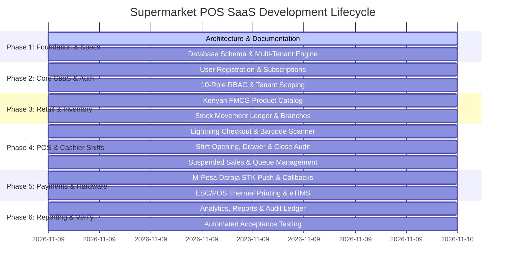

# Project Plan: Enterprise Supermarket POS & Retail Management SaaS Platform

## 1. Project Overview & Vision
A cloud-native, multi-tenant Supermarket Point of Sale (POS) and Retail Enterprise Management SaaS platform built specifically for the Kenyan and East African retail market. The system supports single-till retail kiosks, mini-supermarkets, multi-lane hypermarkets, and regional supermarket chains with centralized multi-branch management.

### Primary Engineering Objectives
1. **Lightning-Fast Checkout:** Sub-100ms barcode scanning to cart addition using local caching, optimistic updates, and streamlined input processing.
2. **Zero-Wait M-Pesa Payments:** Full Safaricom Daraja API integration (STK Push, Till/Paybill C2B) with real-time Server-Sent Events (SSE) payment push, enabling cashiers to serve the next customer while a previous mobile money transaction is pending.
3. **Automatic Receipt Printing:** ESC/POS engine supporting 58mm & 80mm thermal printers, direct network printing, visual receipt preview, and PDF archiving with KRA eTIMS QR codes.
4. **Authentic Kenyan Retail Operations:** Full KES currency modeling, Kenyan EAN-13 barcodes (prefix 616), genuine Fast Moving Consumer Goods (FMCG) catalog, 16% standard VAT & 0% zero-rated food items.
5. **Multi-Tenant SaaS Isolation:** Secure tenant registration, self-service onboarding, subscription tiers (Starter, Growth, Enterprise in KES), role-based access control (10 roles), and tenant-scoped database isolation.
6. **Biometric & Supervisor Control:** Robust supervisor authorization for transaction suspension, resumption, price overrides, and cash drawer management.

---

## 2. Technical Stack Selection & Justification

| Layer | Selected Technology | Technical Justification |
| :--- | :--- | :--- |
| **Runtime & Server** | Node.js v26.5 LTS (Native ESM & CommonJS) | High-performance asynchronous I/O, built-in cryptographic primitives, native SSE and HTTP/2 support. |
| **Database Engine** | SQLite 3 via Node.js native `node:sqlite` (`DatabaseSync`) | Synchronous, zero-latency in-process execution, ACID transactions, zero network latency, instant schema setup, seamlessly upgradable to PostgreSQL/Prisma without rewriting data access patterns. |
| **Real-Time Layer** | Server-Sent Events (SSE) + Long Polling | Fire-and-forget push architecture for M-Pesa callback confirmations, barcode scans, and terminal events without heavy WebSocket handshake overhead. |
| **Payment Gateway** | Safaricom Daraja 2.0 API (STK Push / C2B) | Industry standard in Kenya; provides instant mobile money payments with automated asynchronous callback processing. |
| **Tax Engine** | KRA eTIMS Trader System Specification | Cryptographic CU validation, control unit invoice signing, and compliance with the Kenya Revenue Authority electronic Tax Invoice Management System. |
| **Printing Subsystem** | ESC/POS Binary Protocol Generator | Raw command generation (ESC/POS) for thermal printers, compatible with Epson, Bixolon, Xprinter, and network IP printers. |
| **Frontend Framework** | Single Page Application (Responsive Touch UI) | High-speed, responsive cashier layout, offline product cache, keyboard-wedge barcode scanner handler, and audio feedback. |

---

## 3. Development Phases & Work Breakdown

---

## 4. Key Performance Indicators (KPIs)
- **Cart Line Insertion:** < 15ms.
- **M-Pesa STK Push Trigger:** < 400ms.
- **M-Pesa Callback to Cashier Push Notification:** < 100ms.
- **Thermal Receipt Command Assembly:** < 5ms.
- **Shift Reconciliation Calculation:** Instantaneous.

