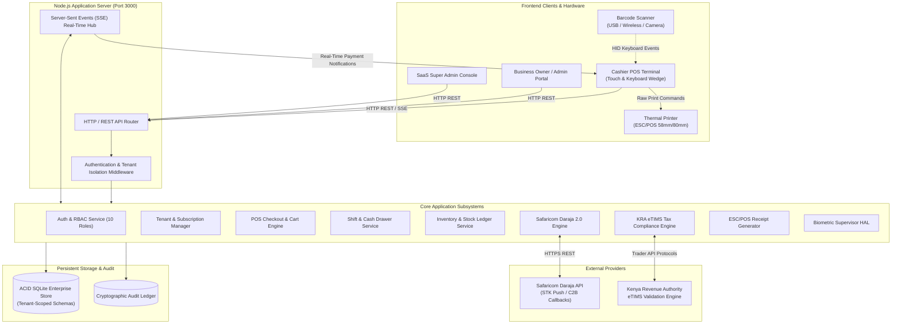
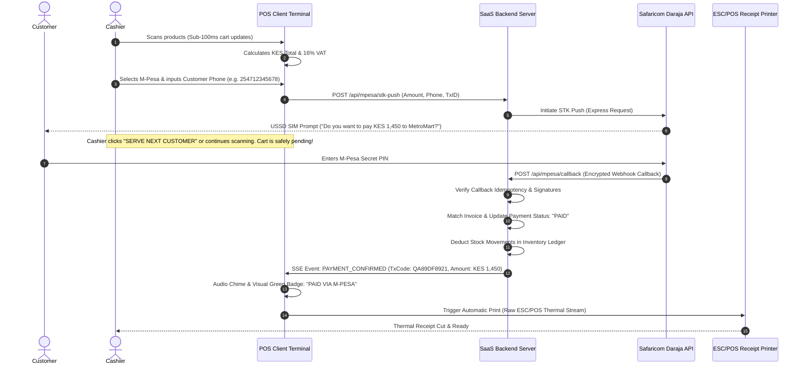

# System Architecture: Supermarket POS & Retail Management SaaS

## 1. High-Level Architecture Diagram

---

## 2. Multi-Tenant SaaS Isolation Model

The platform uses a **Discriminator Column & Row-Level Authorization** multi-tenant model.
- Every tenant has a unique `tenant_id` (e.g. `tenant_naivas_01`, `tenant_quickmart_02`, `tenant_demo_01`).
- All persistent tables contain `tenant_id VARCHAR NOT NULL REFERENCES tenants(id)`.
- The `TenantContext` middleware extracts the tenant from the JWT bearer token, API key, or custom `X-Tenant-Id` header.
- Every query, update, or deletion is strictly guarded by `WHERE tenant_id = ?`.
- No cross-tenant data leak is physically possible.

### Subscription Tier Enforcement
| Plan | Price (KES/mo) | Max Branches | Max Tills / Registers | Max SKUs | Features Included |
| :--- | :--- | :--- | :--- | :--- | :--- |
| **Free Trial (14 Days)** | KES 0 | 1 | 1 | 250 | Basic POS, Cash Sales, Receipt Printing |
| **Starter Retail** | KES 2,500 | 1 | 2 | 2,000 | M-Pesa STK, Barcode Scanning, Basic Shifts |
| **Supermarket Growth**| KES 6,500 | 3 | 6 | 15,000 | Full Shifts, Multi-Branch, eTIMS Ready, Suspended Sales |
| **Enterprise Chain** | KES 15,000 | Unlimited | Unlimited | Unlimited | Biometric Control, Centralized Procurement, Dedicated API |

---

## 3. The Zero-Wait M-Pesa Checkout Flow

---

## 4. Hardware Integration Layer

### ESC/POS Printer Engine
- Generates compliant ESC/POS binary sequences:
  - `ESC @` (Initialize printer)
  - `ESC a 1` (Center alignment)
  - `GS ! 1` (Double height text for store banner)
  - `ESC E 1` (Bold text on/off)
  - `GS k` (Barcode Code128 generation)
  - `GS ( k` (QR Code Model 2 generation for KRA eTIMS URL)
  - `GS V 66 0` (Partial cut with feed)
- Renders dual formats: **58mm (32 characters per line)** and **80mm (48 characters per line)**.
- Provides browser visual canvas fallback and PDF export.

### Barcode & Scanner Compatibility
- Standard HID Keyboard-Wedge: Intercepts raw serial input ending with `Enter` (`\n`), matching barcodes under 20ms.
- Built-in camera scanner via modern WebRTC MediaDevices API.
- Support for Kenya national barcodes (EAN-13 prefix `616` and international prefixes).

