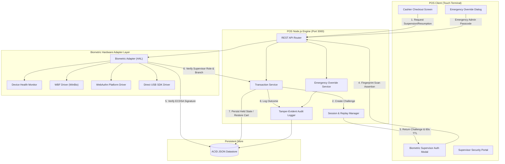

# Supermarket POS Biometric Supervisor Authorization — System Architecture

## Architecture Overview



## Key Workflows

### 1. Suspending a Transaction
1. **Cashier Action:** Cashier clicks `REQUEST SUSPENSION`.
2. **Challenge Creation:** Backend creates a single-use 32-byte nonce expiring in 60s.
3. **Biometric Prompt:** System displays supervisor fingerprint authorization window.
4. **Biometric Scan:** Supervisor touches reader; reader hardware signs challenge with ECDSA P-256 private key.
5. **Validation:** Backend verifies signature against enrolled public key, checks active status, supervisor role, and branch assignment (`BR-001`).
6. **State Save:** Cart items, quantities, prices, and partial payments are snapshotted in `SUSPENDED` state.
7. **Display & Release:** UI displays:
   ```
   SUSPENSION AUTHORIZED
   Supervisor: [Supervisor Name]
   Time: [Timestamp]
   ```
   POS register clears and becomes immediately available for the next customer.

### 2. Resuming a Suspended Transaction
1. **Cashier Action:** Cashier selects held transaction from Suspended Orders.
2. **Fresh Challenge:** System issues a brand new single-use cryptographic challenge (old tokens cannot be reused).
3. **Biometric Scan:** Supervisor places finger on reader.
4. **Validation:** Hardware verifies fingerprint and signs the new challenge.
5. **State Recovery:** Original transaction is restored to `ACTIVE` state:
   - All products, quantities, prices are recovered.
   - All previous partial payments (cash, card, voucher) are validated and restored.
   - Balance due is accurately recalculated.
6. **Display:** UI displays:
   ```
   RESUMPTION AUTHORIZED
   Supervisor: [Supervisor Name]
   Time: [Timestamp]
   ```
   Cashier continues checkout seamlessly.

